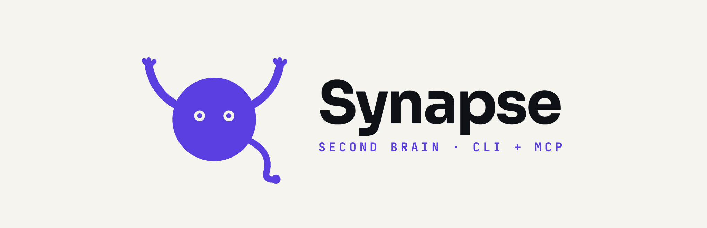

<div align="center">



# Operational memory for agents.

**Governed changes. Preserved history. Explicit integrity checks.**

Keep project knowledge in Markdown and Git. Let agents retrieve context and propose changes you can inspect.

[](https://github.com/romulofebasi/synapse-releases/releases/latest)
[](https://www.npmjs.com/package/@febasi/synapse)
[](VERIFYING-RELEASES.md)
[](LICENSE)

[Install](#install) · [How it works](#what-synapse-is) · [Verify a download](#verify-your-download) · [Documentation](#docs)

</div>

## What Synapse is

Synapse is a local knowledge dependency for people and AI agents. It connects decisions, APIs, tasks, people and runbooks so later work can retrieve the context it needs. The `syn` CLI and MCP server use the same core; your Markdown files remain inspectable, and the SQLite index can be rebuilt.

This is the **public distribution repository**: released binaries, the npm launcher, installation guides and agent instructions. The [product documentation](https://romulofebasi.github.io/synapse/) follows the development branch. Newer development contracts can appear there before they are included in a published binary. Pin a release and check its available commands with `syn --help`.

<picture>
  <source media="(max-width: 600px)" srcset="assets/diagrams/memory-foundation-mobile.svg">
  
</picture>

## Why it matters

An agent should be able to find useful knowledge without silently turning every observation into an accepted fact.

| Your work | Synapse's role | Evidence you can inspect |
|---|---|---|
| Recover project context | Search related facts, decisions and sources | Matching records and their recorded context |
| Change what the project knows | Propose and review supported knowledge changes | Pending payloads, policy outcomes and recorded history |
| Understand a previous change | Inspect attribution and supported past states | `syn blame`, `syn diff`, `syn at` and audit records |
| Check stored records | Run explicit integrity checks | Named invariant results, skipped checks and coverage limits |

Verification checks documented properties of stored records. It does not prove every claim true, detect every contradiction in natural language, or grant organizational authority merely because a local key exists. Signing has prerequisites; an unsigned or skipped check must remain visible.

## Install

<a id="npm-any-platform-with-node-18"></a>

### npm

```bash
npx @febasi/synapse --help
npm install -g @febasi/synapse
syn --version
```

npm installs a companion binary package for the matching operating system and CPU; the Node.js launcher starts that installed executable. Model downloads are a separate, consented step. See [models and privacy](MODELS.md).

The [npm publication contract](docs/adr/0001-authenticated-npm-publication.md)
describes authenticated release inputs, exact package selection and ordered OIDC
publication. Its verification receipt distinguishes controlled tests from an
actual release or npm publish.

<a id="one-liner-macos-linux"></a>

### macOS or Linux installer

```bash
curl -fsSL https://raw.githubusercontent.com/romulofebasi/synapse-releases/main/install.sh | sh
```

For a pinned, reviewable installation, download the script first, inspect it, and set `SYNAPSE_VERSION` to your chosen release tag before running it. `INSTALL_DIR` selects the destination. The current convenience installer attempts checksum verification when the required manifest entry and hash utility are available, and attempts signature verification when `cosign` and the bundle are available. It can continue when evidence is missing or a signature check fails. Use the [manual workflow](#verify-your-download) when both checks must pass.

<a id="windows-powershell"></a>

### Manual download

Choose a tagged archive from [Releases](https://github.com/romulofebasi/synapse-releases/releases), verify it, then extract the `syn` executable to your `PATH`.

| Platform | Target |
|---|---|
| macOS, Apple Silicon | `aarch64-apple-darwin` |
| Linux, x86_64 | `x86_64-unknown-linux-gnu` |
| Linux, ARM64 | `aarch64-unknown-linux-gnu` |
| Windows, x86_64 | `x86_64-pc-windows-msvc` |

Intel macOS binaries are not distributed. Check the selected release's assets and [model compatibility](MODELS.md) before installing.

## Verify your download

<picture>
  <source media="(max-width: 600px)" srcset="assets/diagrams/release-trust-mobile.svg">
  
</picture>

*Trust the download and verify the knowledge separately. A release signature identifies published bytes; `syn verify` checks documented properties of a workspace.*

From a folder containing the archive, `SHA256SUMS` and `SHA256SUMS.cosign.bundle`:

```bash
cosign verify-blob \
  --bundle SHA256SUMS.cosign.bundle \
  --certificate-identity-regexp '^https://github.com/romulofebasi/synapse/\.github/workflows/release\.yml@refs/tags/v' \
  --certificate-oidc-issuer 'https://token.actions.githubusercontent.com' \
  SHA256SUMS
sha256sum --check --ignore-missing SHA256SUMS
```

Both checks must pass for this manual verification workflow. This establishes artifact provenance and checksum agreement, not freedom from defects, Apple notarization or factual truth in a knowledge store. See the [complete verification guide](VERIFYING-RELEASES.md).

## First steps

```bash
syn init ~/brain
cd ~/brain
syn project add "Payments Platform"
syn person add "Maria Silva" --email maria@company.com --job-title "Tech Lead"
syn search payments
syn mcp install
```

The assistant discovers the installed MCP toolset through its client. In the default governed workflow it proposes supported changes; review the exact payload before accepting:

```bash
syn pending list
syn pending show 1
syn pending accept 1
syn verify
```

Inspect the verification report's checks and exclusions. The [onboarding guide](ONBOARDING.md) explains the full local workflow.

## Requirements

| Area | What to plan for |
|---|---|
| Runtime | A compiled binary; npm adds a Node.js 18+ installation/launcher option |
| Local storage | Markdown and Git history, a rebuildable SQLite index and optional model files |
| Semantic models | About 2.5 GB for the default multilingual profile, or a lighter supported profile; downloaded with consent |
| Linux semantic search | A compatible glibc environment; see [MODELS.md](MODELS.md) and the selected release |
| Network and privacy | Model downloads and explicitly configured remote integrations use the network. Local models process locally; hosted embedding providers send configured content to that provider |
| Account | Local Synapse does not require a Synapse account. Connected services keep their own identity and access requirements |

## For your AI assistant

Use the [portable Agent Skill](skills/synapse/SKILL.md) for proposal and retrieval guidance, and [LLM.md](LLM.md) for a compact orientation. Discover the actual tools of the installed version instead of assuming a fixed count.

```bash
syn skill install
```

Synapse complements tools such as Obsidian, Notion, Git and MCP. Soma can consume operational knowledge through a pinned local integration; the product remains independently usable. Development-only contracts and shared authority features must not be assumed available in an older release.

<a id="the-proof"></a>

## Evidence with scope

Internal benchmark records include a 20-question synthetic-persona retrieval evaluation across 463 entities and bounded agent scenarios: insertion 12/15, correction 7/8 and preservation of the existing fact in 10/10 contradiction runs. These are historical observations under the documented conditions, not universal reliability or a comparison against every memory engine.

The [benchmark guide](BENCHMARKS_EXPLAINED.md) explains the measures and limitations. The [development evidence](https://romulofebasi.github.io/synapse/docs/BENCHMARKS.html) separates retrieval, agent behavior and deterministic checks. Changing inputs, models or releases requires a new evaluation before claiming the same results.

<a id="docs"></a>

## Documentation

| Start here | What it explains |
|---|---|
| [Onboarding](ONBOARDING.md) | Create a workspace, connect an agent, review a proposal |
| [Models and privacy](MODELS.md) | Local models, consent, footprint and remote-provider boundaries |
| [Verify releases](VERIFYING-RELEASES.md) | Authenticate the checksum manifest and check an archive |
| [Benchmark guide](BENCHMARKS_EXPLAINED.md) | Read historical evaluation numbers without overstating them |
| [Agent orientation](LLM.md) | Retrieval and proposal habits for the installed toolset |
| [Visual guide](VISUAL_GUIDE.md) | The knowledge model, release trust and diagram maintenance |
| [Development docs](https://romulofebasi.github.io/synapse/) | Current architecture, contracts, ADRs and implementation status |

## Contributing and feedback

This public repository accepts documentation, installer and launcher improvements. The Rust product source is maintained separately.

- [Report a bug](https://github.com/romulofebasi/synapse-releases/issues/new?template=bug_report.yml), including the installed version and platform.
- [Suggest a feature](https://github.com/romulofebasi/synapse-releases/issues/new?template=feature_request.yml), with a concrete workflow.
- Read [CONTRIBUTING.md](CONTRIBUTING.md) before a documentation or installer pull request.
- Follow the [private disclosure policy](.github/SECURITY.md) for security issues.

## License

See [LICENSE](LICENSE) and the notices accompanying the selected distribution.

<div align="center">

<br/>
<sub>A Febasi product. Structure, clarity and intelligence carried into the next task.</sub>
</div>
