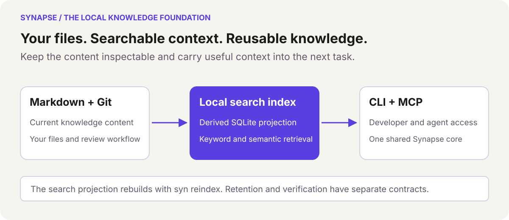
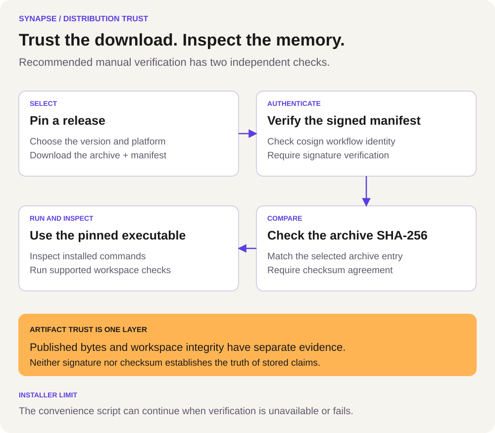

# Synapse public visual guide

Operational memory for agents, with governed changes, preserved history, and explicit integrity checks.

This public repository explains released distribution and onboarding. The product's development documentation can contain newer contracts. Pin a published release, inspect its commands/MCP schemas and read the corresponding evidence before assuming feature availability.

## The local knowledge foundation

<picture>
  <source media="(max-width: 600px)" srcset="assets/diagrams/memory-foundation-mobile.svg">
  
</picture>

The model has three parts:

1. Markdown with YAML frontmatter stores inspectable knowledge content; Git can retain the repository history.
2. A derived local SQLite search projection supports the installed release's keyword, graph and optional semantic retrieval.
3. People and agents use the CLI/MCP interfaces over the same core.

Rebuilding a search index is separate from retaining governance, configuration, keys, pending proposals and other operational state. Do not delete the entire `.synapse/` folder as a repair shortcut. A direct file edit is not equivalent to a supported governed transition.

## Trust the distribution separately

<picture>
  <source media="(max-width: 600px)" srcset="assets/diagrams/release-trust-mobile.svg">
  
</picture>

The strict manual workflow selects an exact release and target, authenticates the checksum manifest with the expected workflow identity, compares the selected archive's SHA-256 and proceeds only after both checks pass. The current convenience installer has optional verification paths and can continue when evidence is missing or signature verification fails. See the exact [verification guide](VERIFYING-RELEASES.md).

Artifact provenance does not establish bug freedom, Apple notarization or truth in the knowledge store. `syn verify` has a separate installed-version contract for named workspace properties. Skipped or unsigned checks remain visible; an old public binary does not inherit every newer development guarantee.

## What the visuals represent

These are conceptual diagrams, not screenshots, performance measurements, live status or independent adoption evidence. They illustrate reusable local knowledge and release trust without promising universal contradiction detection or complete shared authority in an older release.

A compatible local model processes locally after download; an explicitly configured hosted provider or integration has its own network boundary. See [models and privacy](MODELS.md). [Benchmark interpretation](BENCHMARKS_EXPLAINED.md) keeps historical samples and their limits separate from these architecture illustrations.

## Brand and accessible formats

The public README retains the official tracked Synapse wordmark. Cream (`#F6F4EF`), ink (`#1A1A1A`), violet (`#5B3EE0`), muted ink (`#5F596B`) and mustard (`#FFB454`) follow Synapse's existing visual identity. Violet connects stages; mustard marks the trust/evidence distinction. Labels carry meaning independently of color.

SVG source remains editable, with title/description, readable text and a viewBox. No script, foreignObject or external font/image request is required. Optional locally installed Sora falls back to system sans-serif. Markdown provides alt text and searchable prose equivalents. Narrow layouts stack stages using `-mobile.svg` sources below 600 px; standard SVG is the fallback.

| Canonical diagram | Narrow variant |
| :-- | :-- |
| [memory-foundation.svg](assets/diagrams/memory-foundation.svg) | [memory-foundation-mobile.svg](assets/diagrams/memory-foundation-mobile.svg) |
| [release-trust.svg](assets/diagrams/release-trust.svg) | [release-trust-mobile.svg](assets/diagrams/release-trust-mobile.svg) |

## Maintenance and review

Update facts from the selected published contract. Preserve historical anchors, English prose and the [Febasi writing rule](https://github.com/romulofebasi/febasi-standards/blob/main/CONVENTIONS.md#0-writing-rule-applies-everywhere). Keep the current installer behavior distinct from a recommended manual policy. Do not rewrite historical release assets or tags to match a new visual story.

On a system providing librsvg, render examples for inspection:

```bash
rsvg-convert -w 1000 -o /tmp/synapse-release-trust.png assets/diagrams/release-trust.svg
rsvg-convert -w 375 -o /tmp/synapse-release-trust-mobile.png assets/diagrams/release-trust-mobile.svg
rsvg-convert -w 1000 -o /tmp/synapse-memory-foundation.png assets/diagrams/memory-foundation.svg
rsvg-convert -w 375 -o /tmp/synapse-memory-foundation-mobile.png assets/diagrams/memory-foundation-mobile.svg
```

Inspect typography, arrows, trust boundaries, clipping and contrast. Generated previews are review artifacts; SVG is canonical. Retain full benchmark denominators and privacy boundaries when adding data visualizations.
