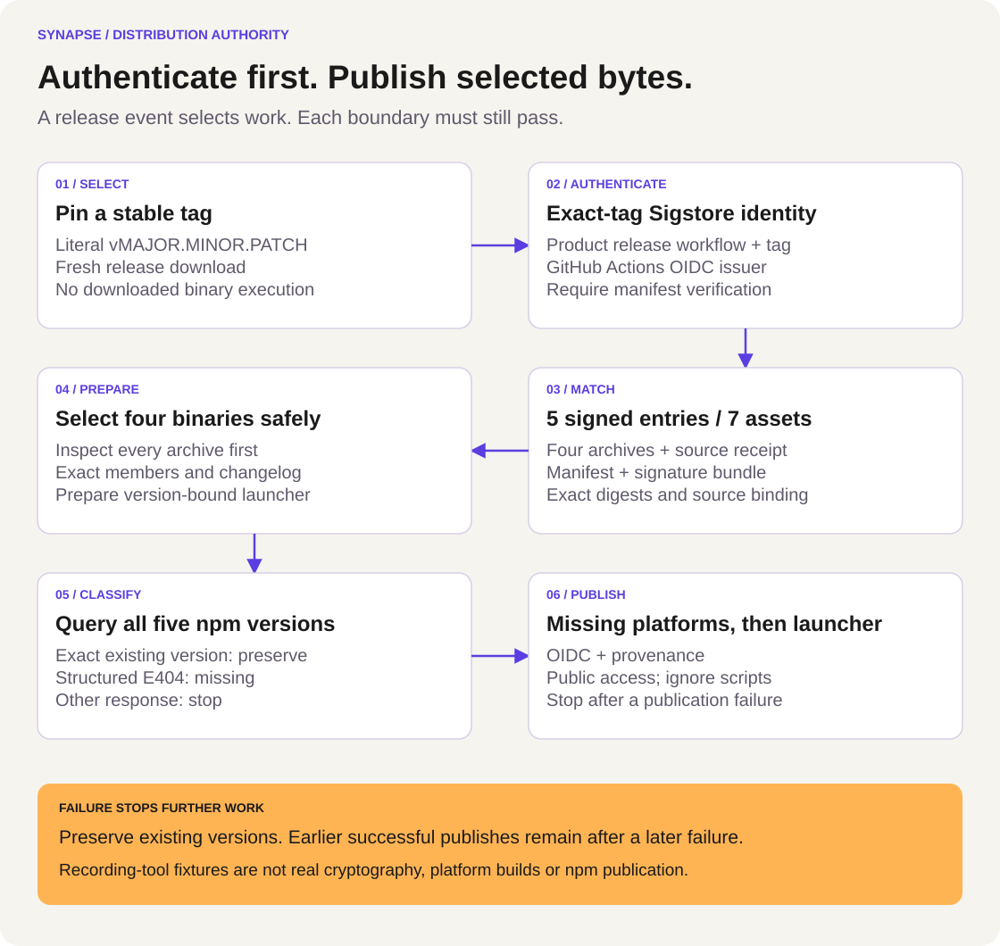

# ADR 0001: Authenticate release inputs before npm publication

Status: Accepted design, implementation verification in progress

Date: 2026-10-17

Tracking: SYN-341. Security details remain in the private issue and disclosure
channel; this public record describes the distribution contract and bounded evidence.

## Context

The private product repository builds the Rust executables. This public repository
distributes release assets and packages their selected binaries for npm. A release
event or manual tag input identifies work to inspect; it does not authenticate the
assets or grant permission to execute their contents.

The archive signature, source receipt, package preparation and npm publication
have separate responsibilities. A correct result must bind the chosen stable tag
to authenticated assets before any registry or publication operation. An npm
registry error must remain an error, rather than becoming permission to publish.

## Decision

Use [publish-npm.py](../../scripts/publish-npm.py) from the
[npm workflow](../../.github/workflows/npm-publish.yml). Pass event data through
environment variables and argument arrays. Accept only a bounded stable tag of
the form `vMAJOR.MINOR.PATCH`, without leading zeroes in numeric components.

<picture>
  <source media="(max-width: 600px)" srcset="../../assets/diagrams/npm-publication-mobile.svg">
  
</picture>

The diagram has this searchable sequence:

1. Validate the stable tag and download exactly the selected release assets from
   `romulofebasi/synapse-releases` into a fresh directory.
2. Verify `SHA256SUMS` with Sigstore. Require the exact certificate identity
   `https://github.com/romulofebasi/synapse/.github/workflows/release.yml@refs/tags/TAG`
   for the selected tag and issuer `https://token.actions.githubusercontent.com`.
3. Require exactly seven assets: four target archives, `release-metadata.json`,
   `SHA256SUMS` and `SHA256SUMS.cosign.bundle`. Require the authenticated manifest
   to contain exactly five entries, the four archives and source receipt, with
   matching SHA-256 values. Reject missing, additional or unsafe asset files.
4. Validate the source receipt's schema, tag, version, commit identifier and
   input digests. Inspect every archive before preparing any package. Require
   the expected binary, README, license and changelog beneath the exact
   top-level directory, optionally including an explicit entry for that directory. Reject unsupported members or duplicate paths.
   Match the changelog to the signed receipt. Copy only the selected executable
   into each companion package; never execute a downloaded binary during assembly.
5. Prepare the launcher with exact-version optional dependencies. Require npm
   CLI 11.5.1 or later. Query all four companion versions and the launcher version
   before publishing anything. An exact existing version is preserved. Only a
   structured `E404` response establishes absence; malformed responses and other
   registry failures stop the attempt.
6. Publish missing companion packages in the declared platform order, then the
   missing launcher, using `--provenance --access public --ignore-scripts`.
   The GitHub-hosted job grants `id-token: write` for npm trusted publishing.
   Configure the matching trusted publisher for each of the five npm packages.

The workflow uses Node 24. npm documents Node 22.14.0 or later and npm CLI 11.5.1
or later as prerequisites for [trusted publishing](https://docs.npmjs.com/trusted-publishers/).
The helper checks the npm version explicitly; setup and the selected workflow
provide the Node runtime. Sigstore's [verification guide](https://docs.sigstore.dev/cosign/verifying/verify/)
explains identity and issuer checks. The pinned tag and exact identity above are
the publication policy, separate from the wider tag-family example in the manual
download guide.

## Alternatives considered

| Option | Decision and tradeoff |
| :-- | :-- |
| Publish npm packages from the private product build | Keep the existing public OIDC publisher and provenance boundary. The source workflow signs exact release inputs; the public worker authenticates and repackages them without a private build checkout. |
| General archive extraction with a safe extraction filter | Select only each exact regular binary through an open archive reader. This avoids writing unrelated members and keeps accepted layouts explicit across tar and ZIP producers. |
| Validate one platform immediately before publishing it | Validate all four platforms and classify all five registry versions first. This catches known incomplete input or registry failures before any publish, while individual later publish failures can still leave a partial release. |

## Failure, retry and historical assets

A failed input, signature, archive or registry-classification gate prevents
publication. A failed individual `npm publish` stops subsequent publishes. The
five packages are not one atomic registry transaction: packages already published
successfully remain. A retry revalidates assets, preserves versions reported as
existing and publishes only confirmed missing versions. Existence is not a
comparison of the registry package's bytes with the newly prepared package.

Do not overwrite original release assets to satisfy a newer contract. Historical
v1.4 assets lack the new source receipt and cannot be republished through this
hardened workflow unchanged. A new compliant release and its separately reviewed
build/signature evidence are required. No tag, release asset or existing npm
version is replaced by this documentation change.

The [convenience installer](../../install.sh) remains unchanged and best-effort.
This publication policy does not make optional installer verification mandatory.
Artifact authentication also does not prove source correctness, platform
compatibility, notarization or workspace knowledge truth.

## Verification and remaining evidence

The [allowlisted receipt](../verification/SYN-341-authenticated-npm-publication.json)
records the original one-assertion RED and the 16-method author GREEN at
`f142eb5`. These tests execute the actual helper and workflow steps with private
temporary files and recording `gh`, `cosign` and `npm` fakes. They test argument,
ordering, byte-selection and failure boundaries. They do not establish real
cryptography, a Rust platform build, registry credentials or actual npm publication.

Independent mutation review, exact-head CI and actual publication after the
existing review gates remain separate evidence. Preserve original survivors and invalid attempts when
strengthening tests. Follow the [Febasi test-first skill](https://github.com/romulofebasi/febasi-standards/blob/main/skills/test-first/SKILL.md),
including actual assertion RED, restored GREEN and independent challenges. Keep
raw runner logs private; publish reviewed counts, digests and explicit limits.
